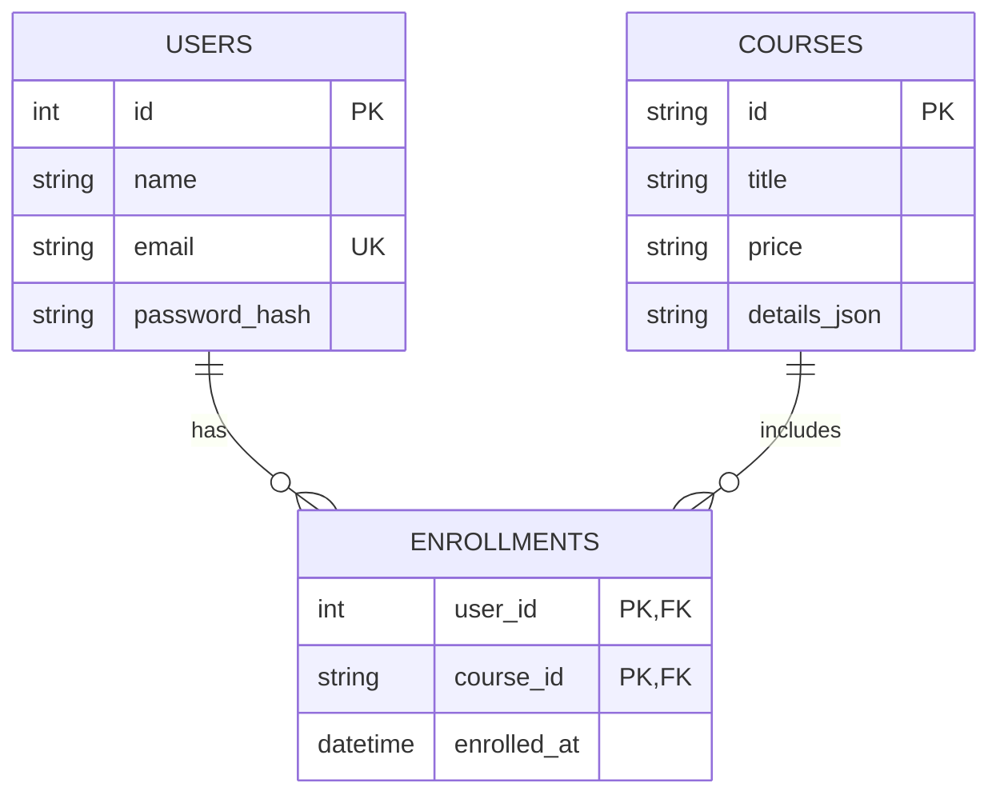

# CourseHub

CourseHub is a course catalog and enrollment app. Visitors can browse free and paid courses, inspect course plans, create an account, sign in, enroll, and see their enrolled courses. The frontend is a React single page app; the backend is an Express JSON API with a SQLite database.

## Contents

- [Features](#features)
- [Technology and concepts](#technology-and-concepts)
- [Architecture](#architecture)
- [Folder structure](#folder-structure)
- [How the app works](#how-the-app-works)
- [Database](#database)
- [Run locally](#run-locally)
- [API routes](#api-routes)
- [Build for production](#build-for-production)
- [Current scope](#current-scope)

## Features

- Browse 24 courses, grouped into free and paid sections.
- Open a course by its URL and read its description, roadmap, weekly topics, prerequisites, projects, and career scope.
- Sign up and sign in.
- Enroll in a course while signed in.
- View enrolled courses and sign out.
- Keep account and enrollment records between server restarts.

## Technology and concepts

| Area | Technology or concept | What it does here |
| --- | --- | --- |
| Frontend | React 19 | Builds the page from reusable components. |
| Frontend | React Router | Handles page URLs without full page reloads. |
| Frontend | React state and effects | Loads API data and updates the page after requests. |
| Frontend | React Hook Form | Reads and validates signup and login forms. |
| Frontend | Tailwind CSS | Styles the existing responsive UI using utility classes. |
| Frontend tooling | Vite | Runs the frontend development server and creates production assets. |
| API | Express 5 | Defines the HTTP API and serves the production frontend build. |
| Backend architecture | MVC | Models handle data, controllers handle requests, and React is the View. Routes connect URLs to controllers. |
| Database | SQLite with Node's `node:sqlite` | Stores users, courses, and enrollments in a local database file. |
| Authentication | bcryptjs and JWT | Hashes account passwords and issues signed bearer tokens after login. |
| Configuration | dotenv | Loads local backend settings from `backend/.env`. |

## Architecture

The backend follows MVC with routes and middleware around it:

1. A **Route** matches an HTTP method and URL, such as `POST /api/auth/login`.
2. A **Controller** validates the request, calls the required model, and creates the JSON response.
3. A **Model** reads or writes records in SQLite.
4. The **View** is the React frontend. It calls the API and renders the response.

Authentication middleware checks bearer tokens before protected enrollment routes. The frontend and API exchange JSON. During development, Vite forwards `/api` requests to the backend.

## Folder structure

```text
CourseHub/
├── README.md
├── backend/
│   ├── config/
│   │   ├── auth.js                 # create and verify JWTs
│   │   ├── database.js             # SQLite connection, schema, course seeding
│   │   └── env.js                  # environment settings and port
│   ├── controllers/
│   │   ├── authController.js       # signup, login, current user
│   │   ├── courseController.js     # list and get course details
│   │   └── enrollmentController.js # list and create enrollments
│   ├── data/
│   │   ├── courseCatalog.json      # course title, price, duration, rating
│   │   ├── courseDetails.json      # course descriptions and learning plans
│   │   └── coursehub.sqlite        # generated database (created on first run)
│   ├── middleware/
│   │   └── requireAuth.js          # verifies the bearer token
│   ├── models/
│   │   ├── courseModel.js          # course queries
│   │   ├── enrollmentModel.js      # enrollment queries
│   │   └── userModel.js            # account queries
│   ├── routes/
│   │   ├── authRoutes.js           # /api/auth/*
│   │   ├── courseRoutes.js         # /api/courses/*
│   │   └── enrollmentRoutes.js     # /api/me/courses/*
│   ├── .env.example
│   ├── app.js                      # Express middleware and route setup
│   ├── package.json
│   └── server.js                   # starts the HTTP server
└── frontend/
    ├── public/                     # static icons and favicon
    ├── src/
    │   ├── assets/                 # images and logos
    │   ├── components/             # page and reusable UI components
    │   ├── data/courseDetails.json # older frontend copy; API uses backend/data
    │   ├── lib/api.js              # shared API request helper
    │   ├── App.jsx                 # route-to-page mapping
    │   ├── main.jsx                # React and BrowserRouter entry point
    │   └── index.css               # global styles and page transition
    ├── package.json
    └── vite.config.js              # dev server and /api proxy
```

### Main frontend components

- `Navbar.jsx`, `Footer.jsx`: shared page layout.
- `ComponentDescription.jsx`: home page content.
- `Courses.jsx`, `CourseCard.jsx`: fetch and display the catalog.
- `ViewCourse.jsx`: fetch and display one course; handles enrollment.
- `Signup.jsx`, `Login.jsx`: account forms that call the auth API.
- `MyCourses.jsx`: fetches the signed-in user's enrollments.
- `PageTransition.jsx`: applies the page transition when the route changes.

## How the app works

1. **Start:** `main.jsx` mounts React inside `BrowserRouter`; `App.jsx` maps URLs to page components.
2. **Load courses:** `Courses.jsx` calls `apiRequest('/courses')`. The Vite proxy sends it to `GET /api/courses`; the controller gets records through `courseModel`.
3. **Open details:** each course has a slug ID, for example `/ViewCourse/react-js`. `ViewCourse.jsx` asks `GET /api/courses/react-js`, so refreshing the page still loads that course.
4. **Sign up:** `Signup.jsx` posts name, email, and password. The controller hashes the password with bcryptjs and the model saves the user.
5. **Sign in:** `Login.jsx` posts email and password. If they match, the API returns a JWT. The frontend keeps the token and sends it as `Authorization: Bearer <token>` on later requests.
6. **Protect account actions:** `requireAuth.js` verifies that token and attaches the matching user to the request.
7. **Enroll:** `ViewCourse.jsx` posts to `/api/me/courses/:id`. The enrollment model links the user and course in SQLite; duplicate enrollment is rejected.
8. **View courses / sign out:** `MyCourses.jsx` fetches the profile and enrollment list. Sign out removes the saved token in the browser.

## Database

CourseHub uses **SQLite**, accessed through Node.js's built-in `node:sqlite` module. The database file is created at `backend/data/coursehub.sqlite` the first time the backend starts. Node.js **22.5 or newer** is required.

SQLite suits this project because the data is small and relational, the app can run without a separate database server, and the database is stored in one file. Enrollments refer to both a user and a course, so foreign keys and a combined user/course key prevent invalid or duplicate links. MongoDB would also work, but would require a separate MongoDB service or Atlas connection for this setup.

Tables:

| Table | Purpose | Important fields |
| --- | --- | --- |
| `users` | Account records | `id`, `name`, unique `email`, `password_hash`, `created_at` |
| `courses` | Catalog and detail data | `id`, `title`, `price`, `duration`, `rating`, `details_json` |
| `enrollments` | User-to-course relationship | `user_id`, `course_id`, `enrolled_at`; `user_id` + `course_id` form the primary key |

The backend seeds course records from `data/courseCatalog.json` and `data/courseDetails.json` on startup. These JSON files are the editable source for the initial catalog; SQLite serves the app after seeding.



## Run locally

Use Node.js 22.5 or newer. Open two terminals from the project root.

**Terminal 1 — backend:**

```powershell
cd backend
npm install
Copy-Item .env.example .env
```

Set `JWT_SECRET` in `backend/.env` to a long random value, then start the API:

```powershell
npm run dev
```

The API listens at `http://localhost:4000`. `backend/data/coursehub.sqlite` is created on first start.

**Terminal 2 — frontend:**

```powershell
cd frontend
npm install
npm run dev
```

Open the local URL printed by Vite. The frontend's `/api` requests are proxied to port 4000. Keep both terminals running while using the app.

## API routes

| Method | Route | Requires login | Purpose |
| --- | --- | --- | --- |
| `GET` | `/api/health` | No | Check that the API is running. |
| `POST` | `/api/auth/signup` | No | Create an account. |
| `POST` | `/api/auth/login` | No | Sign in and receive a JWT. |
| `GET` | `/api/auth/me` | Yes | Get the signed-in user's profile. |
| `GET` | `/api/courses` | No | List all courses. |
| `GET` | `/api/courses/:id` | No | Get a course and its details by slug ID. |
| `GET` | `/api/me/courses` | Yes | List the signed-in user's courses. |
| `POST` | `/api/me/courses/:id` | Yes | Enroll in a course. |

Protected requests must include `Authorization: Bearer <token>`.

## Build for production

The Express backend can serve the frontend build from the same origin:

```powershell
cd frontend
npm run build
cd ../backend
npm start
```

The backend serves `frontend/dist` when it exists, along with `/api`. The current Vercel config only handles the frontend; a separate backend host needs a production `/api` proxy or API URL configuration before deploying frontend and backend separately.

## Common updates and troubleshooting

- **Add or edit a course:** update its metadata in `backend/data/courseCatalog.json` and its detail record in `backend/data/courseDetails.json`. Both records must use the same title. Restart the backend; startup seeding updates the SQLite catalog.
- **Change the API port or database location:** set `PORT` or `DATABASE_PATH` in `backend/.env`. Keep the Vite proxy target in `frontend/vite.config.js` aligned with the backend port if you change the default port.
- **The frontend says it cannot reach the API:** make sure the backend is running in its own terminal at port 4000, then reload the frontend.
- **The API reports a SQLite or Node module error:** check that Node.js is version 22.5 or newer, then run `npm install` in `backend/` again.
- **A protected page sends you to login:** sign in again to receive a current token.

## Current scope

The app includes course catalog and enrollment flows. Enrolling in a paid course currently records the enrollment directly; there is no payment gateway. Courses show descriptions and study plans, but the app does not include lesson videos or a course player. There is no admin dashboard for editing courses.
