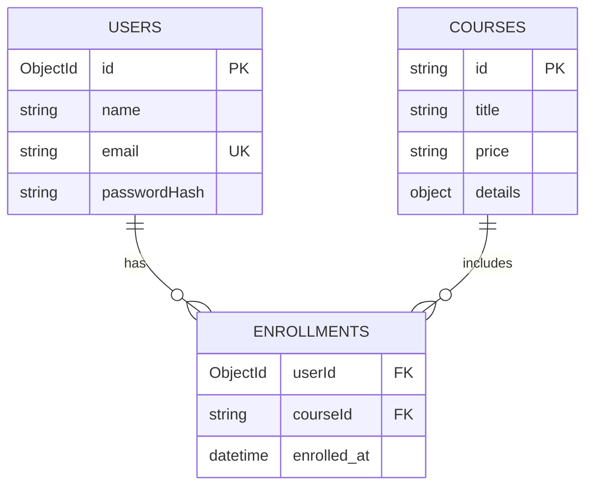

# CourseHub

CourseHub is a course catalog and enrollment app. Visitors can browse free and paid courses, inspect course plans, create an account, sign in, enroll, and see their enrolled courses. The frontend is a React single page app; the backend is an Express JSON API using MongoDB through Mongoose.

## Contents

- [Features](#features)
- [Technology and concepts](#technology-and-concepts)
- [Architecture](#architecture)
- [Folder structure](#folder-structure)
- [How the app works](#how-the-app-works)
- [Database](#database)
- [Run locally](#run-locally)
- [API routes](#api-routes)
- [Deploy to Vercel](#deploy-to-vercel-with-mongodb-atlas)
- [Current scope](#current-scope)

## Features

- Browse 24 courses, grouped into free and paid sections.
- Open a course by its URL and read its description, roadmap, weekly topics, prerequisites, projects, and career scope.
- Sign up and sign in.
- Enroll in a course while signed in.
- View enrolled courses and sign out.
- Keep account and enrollment records between server restarts.

## Technology and concepts

| Area | Technology or concept | What it does here |
| --- | --- | --- |
| Frontend | React 19 | Builds the page from reusable components. |
| Frontend | React Router | Handles page URLs without full page reloads. |
| Frontend | React state and effects | Loads API data and updates the page after requests. |
| Frontend | React Hook Form | Reads and validates signup and login forms. |
| Frontend | Tailwind CSS | Styles the existing responsive UI using utility classes. |
| Frontend tooling | Vite | Runs the frontend development server and creates production assets. |
| API | Express 5 | Defines the HTTP API and is deployed as a Vercel Function. |
| Backend architecture | MVC | Models handle data, controllers handle requests, and React is the View. Routes connect URLs to controllers. |
| Database | MongoDB Atlas or local MongoDB, through Mongoose | Stores users, courses, and enrollments as MongoDB documents. |
| Authentication | bcryptjs and JWT | Hashes account passwords and issues signed bearer tokens after login. |
| Configuration | dotenv and CORS | Loads backend settings and allows the deployed frontend origin to call the API. |

## Architecture

The backend follows MVC with routes and middleware around it:

1. A **Route** matches an HTTP method and URL, such as `POST /api/auth/login`.
2. A **Controller** validates the request, calls the required model, and creates the JSON response.
3. A **Model** validates and reads or writes MongoDB documents through Mongoose.
4. The **View** is the React frontend. It calls the API and renders the response.

Authentication middleware checks bearer tokens before protected enrollment routes. The frontend and API exchange JSON. During development, Vite forwards `/api` requests to the backend.

## Folder structure

```text
CourseHub/
├── README.md
├── backend/
│   ├── config/
│   │   ├── auth.js                 # create and verify JWTs
│   │   ├── database.js             # Mongoose connection and catalog seeding
│   │   └── env.js                  # environment settings and port
│   ├── controllers/
│   │   ├── authController.js       # signup, login, current user
│   │   ├── courseController.js     # list and get course details
│   │   └── enrollmentController.js # list and create enrollments
│   ├── data/
│   │   ├── courseCatalog.json      # course title, price, duration, rating
│   │   ├── courseDetails.json      # course descriptions and learning plans
│   ├── middleware/
│   │   └── requireAuth.js          # verifies the bearer token
│   ├── models/
│   │   ├── Course.js               # Mongoose course schema
│   │   ├── Enrollment.js           # Mongoose enrollment schema and index
│   │   ├── User.js                 # Mongoose user schema
│   │   ├── courseModel.js          # course queries and response mapping
│   │   ├── enrollmentModel.js      # enrollment queries
│   │   └── userModel.js            # account queries and public mapping
│   ├── routes/
│   │   ├── authRoutes.js           # /api/auth/*
│   │   ├── courseRoutes.js         # /api/courses/*
│   │   └── enrollmentRoutes.js     # /api/me/courses/*
│   ├── .env.example
│   ├── app.js                      # Express middleware and route setup
│   ├── package.json
│   └── server.js                   # starts the HTTP server
└── frontend/
    ├── public/                     # static icons and favicon
    ├── src/
    │   ├── assets/                 # images and logos
    │   ├── components/             # page and reusable UI components
    │   ├── data/courseDetails.json # older frontend copy; API uses backend/data
    │   ├── lib/api.js              # shared API request helper
    │   ├── App.jsx                 # route-to-page mapping
    │   ├── main.jsx                # React and BrowserRouter entry point
    │   └── index.css               # global styles and page transition
    ├── package.json
    └── vite.config.js              # dev server and /api proxy
```

### Main frontend components

- `Navbar.jsx`, `Footer.jsx`: shared page layout.
- `ComponentDescription.jsx`: home page content.
- `Courses.jsx`, `CourseCard.jsx`: fetch and display the catalog.
- `ViewCourse.jsx`: fetch and display one course; handles enrollment.
- `Signup.jsx`, `Login.jsx`: account forms that call the auth API.
- `MyCourses.jsx`: fetches the signed-in user's enrollments.
- `PageTransition.jsx`: applies the page transition when the route changes.

## How the app works

1. **Start:** `main.jsx` mounts React inside `BrowserRouter`; `App.jsx` maps URLs to page components.
2. **Load courses:** `Courses.jsx` calls `apiRequest('/courses')`. Locally, Vite proxies it to `GET /api/courses`; the controller gets records through `courseModel`.
3. **Open details:** each course has a slug ID, for example `/ViewCourse/react-js`. `ViewCourse.jsx` asks `GET /api/courses/react-js`, so refreshing the page still loads that course.
4. **Sign up:** `Signup.jsx` posts name, email, and password. The controller hashes the password with bcryptjs and the model saves the user.
5. **Sign in:** `Login.jsx` posts email and password. If they match, the API returns a JWT. The frontend keeps the token and sends it as `Authorization: Bearer <token>` on later requests.
6. **Protect account actions:** `requireAuth.js` verifies that token and attaches the matching user to the request.
7. **Enroll:** `ViewCourse.jsx` posts to `/api/me/courses/:id`. The enrollment model links the user and course in MongoDB; a unique compound index rejects duplicate enrollment.
8. **View courses / sign out:** `MyCourses.jsx` fetches the profile and enrollment list. Sign out removes the saved token in the browser.

## Database

CourseHub uses **MongoDB** through **Mongoose**. Set `MONGODB_URI` to a local MongoDB connection string or a MongoDB Atlas connection string. On startup, the backend connects and upserts the course catalog from `backend/data/courseCatalog.json` and `backend/data/courseDetails.json`.

MongoDB fits the project because course details contain nested lists (roadmaps, weekly topics, projects), and Mongoose lets the backend model those documents with schemas. Atlas also gives the Vercel-hosted API a database service that persists independently of the function runtime.

| Mongoose model / MongoDB collection | Purpose | Important fields |
| --- | --- | --- |
| `User` / `users` | Account records | ObjectId `_id`, `name`, unique normalized `email`, `passwordHash` |
| `Course` / `courses` | Catalog and nested course plan | string `_id` slug, `title`, `price`, `duration`, `rating`, `details` |
| `Enrollment` / `enrollments` | User-to-course relationship | `userId` reference, `courseId` reference, `enrolledAt`; unique compound index on `userId + courseId` |



## Run locally

Use Node.js 22.5 or newer. Open two terminals from the project root.

**Terminal 1 — backend:**

```powershell
cd backend
npm install
Copy-Item .env.example .env
```

Set `MONGODB_URI` to your Atlas connection string and set `JWT_SECRET` in `backend/.env`, then start the API. This local `.env` file is ignored by Git and is not pushed to GitHub.

```powershell
npm run dev
```

The API listens at `http://localhost:4000`. The course catalog is seeded into MongoDB on first connection.

**Terminal 2 — frontend:**

```powershell
cd frontend
npm install
npm run dev
```

Open the local URL printed by Vite. The frontend's `/api` requests are proxied to port 4000. Keep both terminals running while using the app.

## API routes

| Method | Route | Requires login | Purpose |
| --- | --- | --- | --- |
| `GET` | `/api/health` | No | Check that the API is running. |
| `POST` | `/api/auth/signup` | No | Create an account. |
| `POST` | `/api/auth/login` | No | Sign in and receive a JWT. |
| `GET` | `/api/auth/me` | Yes | Get the signed-in user's profile. |
| `GET` | `/api/courses` | No | List all courses. |
| `GET` | `/api/courses/:id` | No | Get a course and its details by slug ID. |
| `GET` | `/api/me/courses` | Yes | List the signed-in user's courses. |
| `POST` | `/api/me/courses/:id` | Yes | Enroll in a course. |

Protected requests must include `Authorization: Bearer <token>`.

## Deploy to Vercel with MongoDB Atlas

The frontend and API are separate Vercel projects in this repository. The backend is an Express app exported from `backend/app.js`; Vercel can deploy Express as a Function. [Vercel Express deployment docs](https://vercel.com/docs/frameworks/backend/express)

1. Create a MongoDB Atlas cluster and database user. Copy its connection string for `MONGODB_URI`; replace the username and password placeholders before saving it.
2. In Vercel, import this repo for the backend project and set **Root Directory** to `backend`.
3. Add backend environment variables in Vercel: `MONGODB_URI`, `JWT_SECRET`, and `CORS_ORIGIN`. Set `CORS_ORIGIN` to the exact deployed frontend origin, such as `https://coursehub-example.vercel.app`.
4. Create/import another Vercel project from the same repo for the frontend. Set **Root Directory** to `frontend`.
5. Add frontend environment variable `VITE_API_URL` with the backend deployment origin plus `/api`, such as `https://coursehub-api-example.vercel.app/api`.
6. Redeploy the frontend after adding `VITE_API_URL`. Vite embeds `VITE_` variables during the build. [Vite on Vercel](https://vercel.com/docs/frameworks/frontend/vite)

For preview deployments, include the frontend preview origin in backend `CORS_ORIGIN`, comma-separated with any other allowed frontend origins. Backend environment variables are set in the Vercel project settings and take effect on a new deployment.

## Common updates and troubleshooting

- **Add or edit a course:** update its metadata in `backend/data/courseCatalog.json` and its detail record in `backend/data/courseDetails.json`. Both records must use the same title. Restart the backend; startup seeding updates MongoDB.
- **Change the API port:** set `PORT` in `backend/.env`. Keep the Vite proxy target in `frontend/vite.config.js` aligned with the backend port if you change the default port.
- **The frontend says it cannot reach the API:** make sure the backend is running in its own terminal at port 4000, then reload the frontend.
- **The API reports a MongoDB connection error:** check that `MONGODB_URI` is set, the Atlas database user and password are correct, and the Atlas network access list allows the backend connection.
- **Vercel frontend requests fail with a CORS error:** set backend `CORS_ORIGIN` to the frontend's exact origin, set frontend `VITE_API_URL` to the backend origin ending in `/api`, then redeploy both projects.
- **Vercel deploy fails to find `package.json`:** confirm the frontend project's Root Directory is `frontend` and backend project's Root Directory is `backend`.
- **A protected page sends you to login:** sign in again to receive a current token.

## Current scope

The app includes course catalog and enrollment flows. Enrolling in a paid course currently records the enrollment directly; there is no payment gateway. Courses show descriptions and study plans, but the app does not include lesson videos or a course player. There is no admin dashboard for editing courses.
