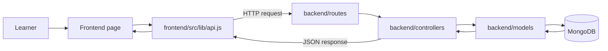

# CourseHub

CourseHub is a small online learning platform project. A visitor can browse courses, create an account, log in, enroll in a course, and see enrolled courses. The frontend is a React app hosted on Vercel. The backend is an Express API hosted on Render, and MongoDB stores user accounts and enrollments.

This is a learning and portfolio project. Course enrollment is recorded without taking payment. A payment gateway can be added later.

## Folder map

```text
CourseHub/
├── README.md                   Project setup and explanation
├── frontend/                   Website shown to learners
│   └── src/
│       ├── main.jsx             Starts React and page routing
│       ├── app.jsx              Connects URL paths to page components
│       ├── index.css            Global styles
│       ├── lib/
│       │   └── api.js           Sends requests to the backend and adds the login token
│       └── components/          Website pages and shared parts
│           ├── home-page.jsx        Home page
│           ├── courses.jsx          Course list page
│           ├── course-card.jsx      One course in the list
│           ├── course-details.jsx   Details and enroll button
│           ├── signup.jsx           Create account form
│           ├── login.jsx            Login form
│           ├── my-courses.jsx       Signed-in learner's courses and logout
│           ├── navbar.jsx           Top navigation
│           ├── footer.jsx           Bottom links and contact details
│           └── page-transition.jsx  Small transition when changing pages
└── backend/                    API and database code
    ├── server.js               Starts the API server
    ├── app.js                  Sets up CORS, JSON, database connection, and routes
    ├── config/
    │   ├── settings.js          Reads environment settings like PORT and JWT_SECRET
    │   ├── database.js          Connects to MongoDB and loads the course data
    │   └── tokens.js            Creates and checks login tokens
    ├── routes/                 Connects API URLs to request handlers
    │   ├── auth.js              Signup, login, and current-account URLs
    │   ├── courses.js           Course list and course detail URLs
    │   └── enrollments.js       Learner enrollment URLs
    ├── controllers/            Checks requests and decides what response to send
    │   ├── auth.js              Signup and login steps
    │   ├── courses.js           Course request steps
    │   └── enrollments.js       Enrollment request steps
    ├── middleware/
    │   └── auth.js              Checks the login token for private URLs
    ├── models/                 MongoDB shapes and database queries
    │   ├── user.js              Account fields
    │   ├── users.js             Account database queries
    │   ├── course.js            Course fields
    │   ├── courses.js           Course database queries
    │   ├── enrollment.js        Enrollment fields
    │   └── enrollments.js       Enrollment database queries
    └── data/
        ├── courses.json         Course title, price, duration, and rating
        └── course-details.json  Course descriptions and learning plans
```

### How a website request reaches the database



Think of the backend folders this way: a **route** picks the request, a **controller** handles the steps, and a **model** reads or writes the database.

## Main app flows

### Browse a course

1. `app.jsx` shows `courses.jsx` for `/courses`.
2. `courses.jsx` asks `api.js` for `GET /api/courses`.
3. The backend route calls the courses controller, which asks the course model for the list.
4. The backend sends JSON back. React displays a `course-card.jsx` for each course.
5. Selecting a card opens `course-details.jsx`, which requests `GET /api/courses/:id`.

Course information starts in the two JSON files in `backend/data/`. The backend loads or updates these records in MongoDB when it connects. When adding a course, keep its title the same in both files.

### Sign up and log in

1. `signup.jsx` sends the name, email, and password to `POST /api/auth/signup`.
2. The auth controller checks the input and saves a hashed password through the user model. The original password is not stored.
3. `login.jsx` sends the email and password to `POST /api/auth/login`.
4. The backend checks the password and returns a signed login token.
5. The frontend stores the token in browser storage. `api.js` sends it with requests that require login.

### Enroll and view enrolled courses

1. The Enroll button sends `POST /api/me/courses/:id`.
2. The auth middleware checks the token before the enrollment controller runs.
3. The controller checks that the course exists and that the learner has not already enrolled, then saves the enrollment.
4. `my-courses.jsx` requests the learner account and enrollment list and displays them. Logout removes the saved login information.

At the moment, enrollment does not charge money. Paid course labels are for the demo catalog only.

## API routes

| Method | URL | What it does | Login needed? |
| --- | --- | --- | --- |
| `GET` | `/api/health` | Checks the API and database connection | No |
| `POST` | `/api/auth/signup` | Creates an account | No |
| `POST` | `/api/auth/login` | Checks credentials and returns a token | No |
| `GET` | `/api/auth/me` | Returns the signed-in account | Yes |
| `GET` | `/api/courses` | Returns the course list | No |
| `GET` | `/api/courses/:id` | Returns one course | No |
| `GET` | `/api/me/courses` | Returns the learner's enrolled courses | Yes |
| `POST` | `/api/me/courses/:id` | Enrolls the learner in a course | Yes |

## Run the project locally

You need Node.js and a MongoDB connection string. Open two terminals in the project folder.

**Terminal 1 — backend:**

```powershell
cd backend
npm install
Copy-Item .env.example .env
npm run dev
```

Put your MongoDB connection string in `backend/.env` as `MONGODB_URI`. Set a private value for `JWT_SECRET`. The API uses port 4000 by default.

**Terminal 2 — frontend:**

```powershell
cd frontend
npm install
npm run dev
```

Open the local URL printed by Vite. The frontend example environment uses the deployed Render API. To use the local backend, create `frontend/.env` with:

```text
VITE_API_URL=http://localhost:4000
```

## Deployment

**Render:** use `backend` as the service root directory, `npm install` as the build command, and `npm start` as the start command. Add `MONGODB_URI`, `JWT_SECRET`, and `CORS_ORIGIN` in the Render environment settings. `CORS_ORIGIN` should be your Vercel website address.

**Vercel:** use `frontend` as the project root directory and set `VITE_API_URL=https://coursehub-c006.onrender.com`. Redeploy after changing this value.

## Possible future feature: payments

A payment gateway is not connected yet. When adding one, the payment should be confirmed by the backend before creating an enrollment. A simple place to grow the project would be:

- Frontend: add a checkout page/component under `frontend/src/components/`.
- Backend: add a payment route and controller under `backend/routes/` and `backend/controllers/`.
- Database: add a payment model under `backend/models/` to save the course, learner, amount, and payment status.

The exact payment steps depend on the gateway chosen later. Do not mark a paid course as enrolled just because the learner clicked the payment button; first verify the successful payment on the backend.
